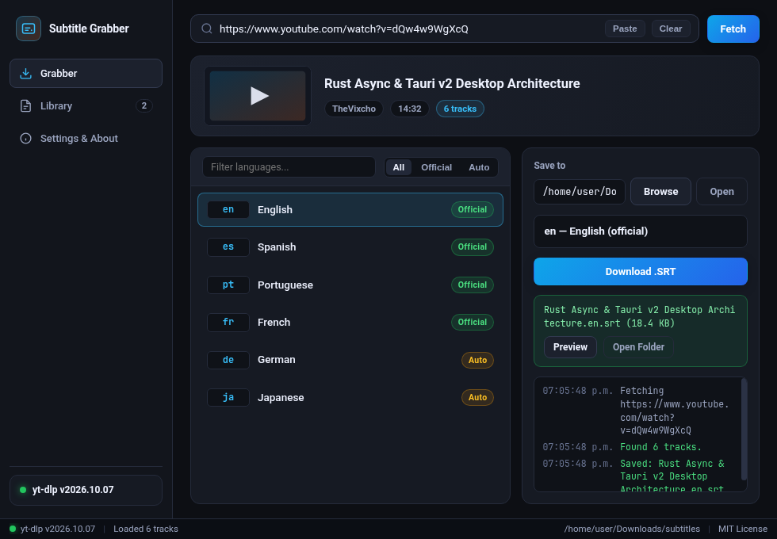
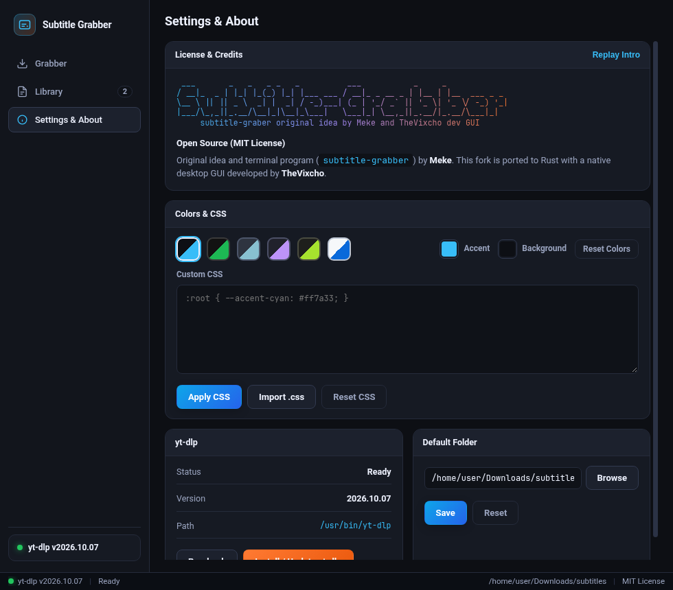

# Subtitle-Grabber in Rust

Cross-platform desktop application for downloading YouTube subtitles as `.srt` files, built with **Rust** and **Tauri v2**.

```text
 ___       _   _   _ _   _          ___           _     _             
/ __|_  _ | |_| |_(_) |_| |___ ___ / __|_ _ __ _ | |__ | |__  ___ _ _ 
\__ \ || || _ \  _| |  _| / -_)___| (_ | '_/ _` || '_ \| '_ \/ -_) '_|
|___/\_,_||_.__/\__|_|\__|_\___|   \___|_| \__,_||_.__/|_.__/\___|_|  
     subtitle-graber original idea by Meke and TheVixcho dev GUI
```

## Screenshots





## Architecture and Stack

- **Backend**: Pure Rust (`tokio`, `serde`, `reqwest`, `rfd`, `opener`) handling process execution, JSON track parsing, native file dialogs, and `.srt` detection.
- **Desktop Runtime**: **Tauri v2** using the operating system's native WebView (WebKitGTK on Linux, WebView2 on Windows, WKWebView on macOS) with no Electron or Node.js runtime dependency.
- **Subtitle Engine**: Powered by `yt-dlp` (either detected from system `PATH` or automatically downloaded on demand by the application).

## Features

- Fetch official and auto-generated YouTube subtitle tracks while filtering out machine-translated `tlang=` entries.
- Video preview card displaying thumbnail, title, channel, and duration.
- Track search and filtering (`All`, `Official`, `Auto`).
- Native OS folder selection dialog and built-in `.srt` library previewer.
- Built-in color palette swatches, background/accent color pickers, plus a live Custom CSS editor and `.css` file importer.
- Built-in one-click `yt-dlp` downloader if `yt-dlp` is not installed on the system.

---

## System Prerequisites (Building from Source)

Install the Rust toolchain via [rustup](https://rustup.rs/) (`rustc` and `cargo`), plus the WebView system dependencies for your platform:

### Linux

**Arch Linux:**
```bash
sudo pacman -S --needed webkit2gtk-4.1 base-devel gtk3 curl
```

**Ubuntu / Debian:**
```bash
sudo apt update
sudo apt install -y libwebkit2gtk-4.1-dev build-essential curl libssl-dev pkg-config libgtk-3-dev libayatana-appindicator3-dev librsvg2-dev
```

**Fedora:**
```bash
sudo dnf install -y webkit2gtk4.1-devel gtk3-devel openssl-devel gcc
```

### Windows

- Windows 10/11 (Microsoft Edge WebView2 is preinstalled on Windows 11 and modern Windows 10).
- Visual Studio C++ Build Tools (Desktop development with C++).
- Rust toolchain via `rustup-init.exe`.

### macOS (Apple Silicon & Intel)

- Xcode Command Line Tools:
```bash
xcode-select --install
```
- Rust toolchain:
```bash
curl --proto '=https' --tlsv1.2 -sSf https://sh.rustup.rs | sh
```

---

## Compile and Run from Source

```bash
git clone https://github.com/TheVixcho/subtitle-grabber-in-Rust.git
cd subtitle-grabber-in-Rust

cargo run
```

To produce an optimized release binary:

```bash
cargo build --release
```

The compiled executable will be located at:
- **Linux / macOS**: `target/release/subtitle-grabber-in-rust`
- **Windows**: `target\release\subtitle-grabber-in-rust.exe`

---

## Install via Terminal

### Using Cargo (Linux, macOS, Windows)

Install directly from Git into Cargo's binary directory (`~/.cargo/bin`):

```bash
cargo install --git https://github.com/TheVixcho/subtitle-grabber-in-Rust.git
```

### Using `curl` (Prebuilt Release Binary, when published on GitHub Releases)

**Linux (x86_64):**
```bash
curl -fsSL https://github.com/TheVixcho/subtitle-grabber-in-Rust/releases/latest/download/subtitle-grabber-linux -o ~/.local/bin/subtitle-grabber
chmod +x ~/.local/bin/subtitle-grabber
```

**macOS:**
```bash
curl -fsSL https://github.com/TheVixcho/subtitle-grabber-in-Rust/releases/latest/download/subtitle-grabber-macos -o /usr/local/bin/subtitle-grabber
chmod +x /usr/local/bin/subtitle-grabber
```

**Windows (PowerShell / cmd with `curl.exe`):**
```powershell
mkdir "$env:LOCALAPPDATA\Programs\subtitle-grabber" -Force
curl.exe -fsSL https://github.com/TheVixcho/subtitle-grabber-in-Rust/releases/latest/download/subtitle-grabber-windows.exe -o "$env:LOCALAPPDATA\Programs\subtitle-grabber\subtitle-grabber.exe"
```

---

## Configuring `yt-dlp`

The application checks for `yt-dlp` in two places in order:
1. System `PATH` (`yt-dlp` / `yt-dlp.exe`).
2. Local managed directory:
   - **Linux**: `~/.local/share/subtitle-grabber-in-rust/yt-dlp`
   - **macOS**: `~/Library/Application Support/subtitle-grabber-in-rust/yt-dlp`
   - **Windows**: `%LOCALAPPDATA%\subtitle-grabber-in-rust\yt-dlp.exe`

### Option A: Automatic Setup (Inside the App)

If `yt-dlp` is missing, click **Install yt-dlp** in the top banner, sidebar, or **Settings & About** tab. The app downloads the official standalone binary from `yt-dlp/yt-dlp` GitHub Releases and verifies it automatically.

### Option B: Manual System Installation

**Linux:**
```bash
# Arch Linux
sudo pacman -S yt-dlp

# Debian / Ubuntu / Fedora via curl
mkdir -p ~/.local/bin
curl -fsSL https://github.com/yt-dlp/yt-dlp/releases/latest/download/yt-dlp_linux -o ~/.local/bin/yt-dlp
chmod +x ~/.local/bin/yt-dlp
```

**macOS:**
```bash
brew install yt-dlp
```

**Windows (PowerShell):**
```powershell
winget install yt-dlp.yt-dlp
```

---

## Colors and Custom CSS

Open **Settings & About -> Colors & CSS** to select a color palette swatch, pick custom background and accent colors, or apply custom CSS overrides directly in the editor or by importing a `.css` file.

Useful CSS custom properties you can override:

```css
:root {
  --bg-root: #0d0f14;
  --bg-sidebar: #12151c;
  --bg-panel: #161a23;
  --bg-elevated: #1c212d;
  --bg-input: #0f1218;
  --border: #252b3b;
  --text-primary: #eef2ff;
  --text-secondary: #9aa4bf;
  --accent-cyan: #38bdf8;
  --accent-orange: #ff7a33;
  --btn-primary-bg: linear-gradient(135deg, #0ea5e9, #2563eb);
}
```

---

## Running Tests

```bash
cargo test
```

---

## Credits and License

- Original terminal concept and Python `subtitle-grabber` project by **Meke**.
- Ported to Rust + Tauri v2 desktop GUI by **TheVixcho**.
- Open Source under the [MIT License](LICENSE).
